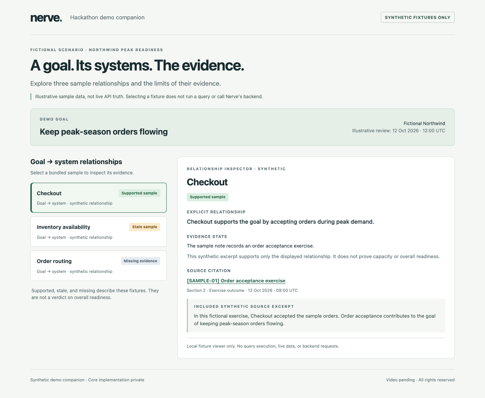
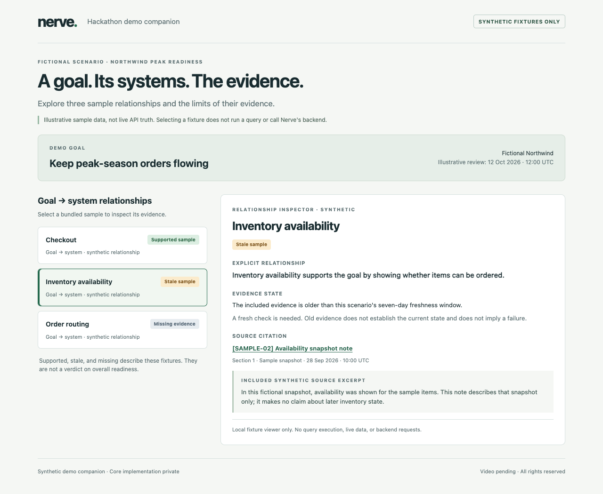

# Nerve · synthetic demo companion

A deliberately small hackathon companion showing how a goal can be connected to a system and an evidence citation, while keeping missing and stale evidence visible.

**All Northwind Peak Readiness names, relationships, excerpts, dates, and states in this repository are independently authored synthetic fixtures.** They are demonstrative sample data, not live API results, captured customer data, or verified statements about real systems.

## Try it

Open `index.html` directly in a modern browser. No install or build is required. Alternatively, from this directory run:

```sh
python3 -m http.server 8000 --bind 127.0.0.1
```

Then open `http://127.0.0.1:8000`. Select each of the three sample relationships to inspect its state and source. Stop the optional server with Ctrl+C.

The viewer only switches between bundled fixtures. It does not run a query, call Nerve's backend, fetch external data, or contact an API. No external scripts, fonts, analytics, or dependencies are used.

## What the example shows

- **Goal:** keep peak-season orders flowing for fictional Northwind.
- **Relationship:** each sample explicitly connects that goal to a named system.
- **Evidence:** a citation leads to an included synthetic source excerpt.
- **Limits:** stale evidence needs a fresh check; missing evidence does not mean a system failed. A supported fixture relationship does not establish overall readiness.

## Scope

This is a **synthetic demo companion**. Nerve's core implementation is private. This repository contains only this minimal static viewer, sample fixtures, documentation, and screenshots generated from the viewer. It contains no backend implementation or original private Git history.

It is not a production UI, an implementation of Veer's interface, or a claim that this viewer implements Nerve's core capabilities.

**Video:** [Watch the submitted demo on YouTube](https://www.youtube.com/watch?v=eK-YCyHIglw). [Devpost submission](https://devpost.com/software/nerve-qeft3v).

## Screenshots

Both screenshots show only this viewer and synthetic fixtures.





## Rights

Copyright © 2026 Krish Verma. All rights reserved. No permissive open-source license is granted; see [RIGHTS.md](RIGHTS.md).
